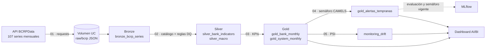

# Monitor de salud bancaria del Perú · Databricks

Pipeline de datos en **Databricks** que mide, cada mes, la salud de los bancos peruanos con datos públicos del **BCRP**. Incluye:
- ingesta desde la API y arquitectura **medallion (Bronze/Silver/Gold) en Delta Lake**, con controles de calidad;
- un **semáforo explicable tipo CAMELS** que dice qué bancos se están desviando y **por qué**;
- seguimiento en **MLflow** y monitoreo de **drift**.

> Solo datos públicos de [BCRPData](https://estadisticas.bcrp.gob.pe/estadisticas/series/). Corre en **Databricks Free Edition** (serverless + Unity Catalog).

## Qué responde

*"Este mes, ¿qué banco se está deteriorando más que el sistema, en qué dimensión y por qué?"*

Semáforo de ago-2026 (último mes publicado), salida real del pipeline:

| Banco | Nivel | Cartera | Eficiencia | Solvencia | Rentabilidad | Motivo |
|---|---|---|---|---|---|---|
| Falabella | media | 🟢 | 🟢 | 🔴 | 🟢 | El ratio de capital cayó en 12 meses más que el del sistema |
| Scotiabank | media | 🟢 | 🟢 | 🔴 | 🟢 | El ratio de capital cayó en 12 meses más que el del sistema |
| Banco Pichincha | vigilar | 🟢 | 🟡 | 🟢 | 🟢 | La eficiencia empeoró en 12 meses más que la del sistema |
| Santander | vigilar | 🟢 | 🟡 | 🟢 | 🟢 | La eficiencia empeoró en 12 meses más que la del sistema |
| BBVA | vigilar | 🟡 | 🟢 | 🟢 | 🟢 | La morosidad subió en 3 meses más que la del sistema |
| Otros 8 bancos | normal | 🟢 | 🟢 | 🟢 | 🟢 | — |

## Arquitectura



| Capa | Tabla | Contenido |
|---|---|---|
| Bronze | `bronze_bcrp_series` | Valores tal cual llegan de la API, con archivo de origen y fecha de ingesta |
| Silver | `silver_bank_indicators` | Series unidas al catálogo (indicador, banco, unidad) y marcadas como comparables o no |
| Silver | `silver_macro` | Tasa de referencia, inflación, PBI, tipo de cambio y crédito privado |
| Gold | `gold_bank_monthly` | Banco × mes: morosidad, eficiencia, ratio de capital, utilidad mensual, variación 12m, ranking |
| Gold | `gold_system_monthly` | Lo mismo para el total del sistema bancario |
| Gold | `gold_alertas_tempranas` | Semáforo por dimensión, nivel de alerta y motivos, banco × mes (histórico completo) |
| Monitoreo | `monitoring_drift` | PSI de cada señal del monitor (historia vs. últimos 12 meses) |

## Datos

`config/series.csv` lista las 107 series: 6 indicadores por banco para 16 bancos y el total del sistema (participación en colocaciones, crecimiento de colocaciones, morosidad, eficiencia, utilidad acumulada y "palanca global"), más 6 series macro.

Hallazgos de calidad de datos que el pipeline maneja:
- **Orden de la API:** el BCRP devuelve las series ordenadas por código, no en el orden pedido. El parser reordena los códigos; hay un test con una respuesta real.
- **Quiebre metodológico:** la morosidad cambia de metodología en ene-2018 (antes viene neta de provisiones, con valores negativos). Esos meses se marcan `is_comparable = false` y se excluyen.
- **"Palanca global"** es en realidad el **ratio de capital global (%)**: más alto = más solvente. Salta para todos los bancos en ene-2023 por un cambio de norma.
- **La utilidad es acumulada en el año** (se reinicia cada enero): se convierte a mensual y se suma en 12 meses.
- La capa Silver **falla el job** si hay series sin catálogo, claves duplicadas o morosidad fuera de rango.

## El semáforo (notebook 04)

Hay cuatro dimensiones tipo CAMELS. En cada una, la señal es **relativa al sistema bancario**: así un choque común (COVID, cambio de norma de capital, estacionalidad de enero) no enciende a todos los bancos.

| Dimensión | Señal | 🔴 rojo | 🟡 amarillo |
|---|---|---|---|
| Calidad de cartera | Δ morosidad en 3 y 6 meses vs. sistema; racha de meses subiendo | z > 2 o 4+ meses seguidos subiendo | z > 1 o 3 meses seguidos |
| Eficiencia | Δ gastos operativos / margen en 12 meses vs. sistema | z > 2 | z > 1 |
| Solvencia | Caída del ratio de capital en 12 meses vs. sistema | z > 2 | z > 1 |
| Rentabilidad | Caída de la utilidad de 12 meses vs. sistema; paso a pérdidas | z > 2 o pasó a pérdidas | z > 1 |

- **z-score contra la historia previa del propio banco** (ventana creciente, mínimo 24 meses). Nunca usa el mes actual ni el futuro, y hay un test que lo verifica: si se altera el futuro, el pasado no cambia.
- **Nivel:** *alta* = 2 o más dimensiones en rojo · *media* = 1 en rojo · *vigilar* = alguna en amarillo.
- Se excluyen Citibank e ICBC (banca corporativa, morosidad ≈ 0).
- Los umbrales son convenciones fijadas de antemano; no se ajustaron mirando resultados.

## Evaluación — honesta

**Pregunta:** en 2023 hubo varios episodios de deterioro (la morosidad del banco sube ≥ 1 pp en 6 meses: Azteca, Falabella, MiBanco, Ripley, Santander). ¿El monitor los marcó?

Periodo ene-2023 → feb-2026: 494 banco-mes, 9 episodios, tasa base 6.1%. Se reproduce con `python scripts/backtest_early_warning.py`.

| | Banco-mes en alerta | Precisión | Episodios marcados **antes** de empezar | Episodios marcados **mientras ocurrían** |
|---|---|---|---|---|
| Semáforo (media + alta) | 123 (25%) | 9.8% | 4 de 9 | **8 de 9** |
| Regla ingenua "la morosidad subió en 3 meses" | 213 (43%) | 9.4% | 7 de 9 | 9 de 9 |

**Lectura:**
- El semáforo **sí sirve como monitor**: marcó 8 de los 9 episodios mientras ocurrían, con ~40% menos meses en alerta que la regla ingenua, y además explica la causa.
- También cubre dimensiones que la regla ingenua no mira: hoy, por ejemplo, la caída de capital de Falabella y Scotiabank.
- **No sirve para anticipar.** Para eso, la propia tendencia de la morosidad es tan buena o mejor.

### Lo que no funcionó (y por qué el proyecto es un monitor y no un pronóstico)

1. **Pronóstico de morosidad a 3 y 12 meses** (panel de 15 bancos, Ridge y Gradient Boosting, con validación separada del test). Ningún modelo le ganó de forma estable al baseline "la morosidad no cambia": a 3 meses el mejor (GBR) quedó 3–6% peor en MAE; a 12 meses Ridge mejoró 26% en test pero empeoró 68% en validación (inestable). Se probaron también predecir el cambio, agregar macro con rezago, quitar el COVID y una clasificación "¿sube > 0.2 pp?" (AUC 0.55–0.60). La morosidad es muy persistente y los datos mensuales públicos no traen señal suficiente. Código archivado en `experiments/` y en `src/bank_health/features.py` / `model.py`.
2. **Anticipación de deterioros** (`python scripts/experimento_alertas.py`). Protocolo: entrenamiento hasta 2021-06, elección del candidato en validación (2021-07 → 2022-12) y una sola mirada al test (2023+). Métrica principal: *average precision* (AP).

   | Candidato | AP validación | AP test | AUC test |
   |---|---|---|---|
   | Ingenua: Δ morosidad 3 meses | 0.21 | 0.12 | 0.59 |
   | **Racha de meses con morosidad subiendo** (elegido en validación) | **0.42** | **0.16** | **0.64** |
   | Isolation Forest sobre las señales | 0.09 | 0.07 | 0.44 |
   | Regresión logística (señales + momentum) | 0.17 | 0.23 | 0.67 |

   La racha supera a la regla ingenua, pero con 9 episodios en el test la diferencia no es concluyente. El **Isolation Forest quedó por debajo del azar**, así que se descartó. La logística salió mejor en el test, pero no fue la elegida en validación, y elegirla ahora sería hacer trampa. Conclusión: con estos datos no se puede afirmar que el sistema "anticipa deterioros", así que no se vende como tal.

## Cómo correrlo en Databricks Free Edition

1. **Importar el repo:** *Workspace → Create → Git folder* y pega la URL de este repositorio.
2. **Setup:** corre `notebooks/00_setup.py`. Crea el esquema `workspace.bank_health` y el volumen `raw`.
3. **Ingesta:** corre `01_bronze_ingest.py`, que descarga las series desde la API del BCRP.
   - Plan B sin internet: corre en tu PC `python scripts/download_bcrp.py` y sube los JSON de `data/raw/` a `/Volumes/workspace/bank_health/raw/bcrp/`.
4. **Resto del pipeline:** corre `02` → `05` en orden. El `04` escribe el semáforo y registra la evaluación en el experimento MLflow `bank_health_monitor`.
5. **Dashboard:** crea un *AI/BI Dashboard* con las consultas de `dashboards/queries.sql`: semáforo vigente, histórico de alertas, motivos más frecuentes y drift.
6. **Job mensual (opcional):** `databricks bundle deploy` crea el job de `databricks.yml` (00 → 05 en serverless, el día 20 de cada mes; viene en pausa).

## Desarrollo local

La lógica vive en `src/bank_health/` en Python puro (pandas/numpy), así que se prueba sin Spark:

```bash
pip install -r requirements.txt
pytest                                    # 10 pruebas
python scripts/backtest_early_warning.py  # evaluación del semáforo con datos reales (data/snapshot/, oct-2026)
python scripts/experimento_alertas.py     # experimento de anticipación (validación + test)
```

```
├── config/series.csv              catálogo de series del BCRP
├── src/bank_health/               cliente API, calidad, semáforo (early_warning.py), drift
├── notebooks/                     00_setup → 05_drift_monitoring (formato fuente de Databricks)
├── experiments/                   pronóstico de morosidad descartado (referencia)
├── scripts/                       evaluación, experimento y descarga local
├── data/snapshot/                 descarga real de la API (oct-2026) para reproducir resultados
├── dashboards/queries.sql         consultas del dashboard
├── databricks.yml                 Asset Bundle con el job mensual
└── tests/                         pruebas con pytest
```

## Stack

Databricks (Unity Catalog, Delta Lake, serverless, Jobs, Asset Bundles) · PySpark · MLflow · pandas · scikit-learn · SQL · API REST del BCRP

## Autor

Carlos Sosa Lupuche · [LinkedIn](https://www.linkedin.com/in/carlos-sosa-lupuche-02670224b/) · [GitHub](https://github.com/wonderless)
